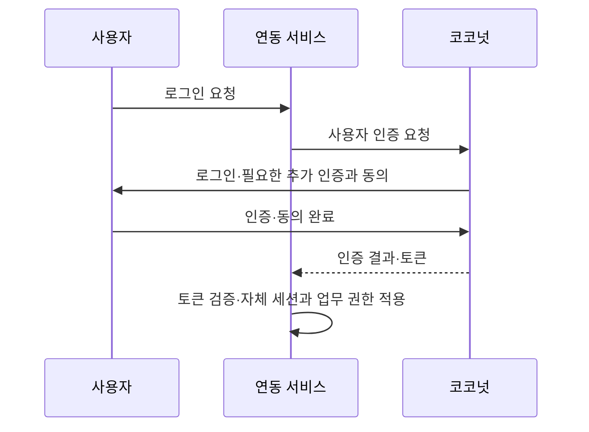
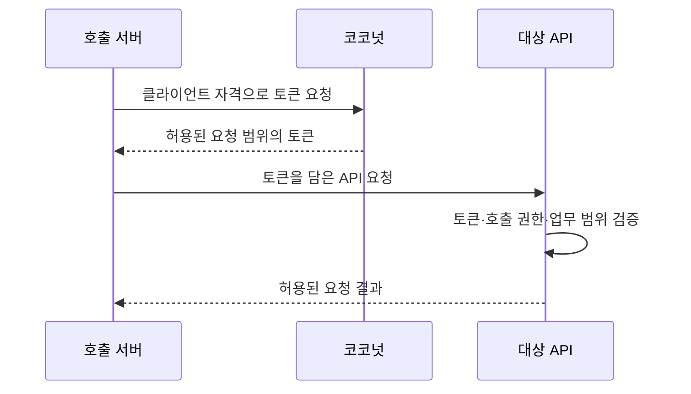
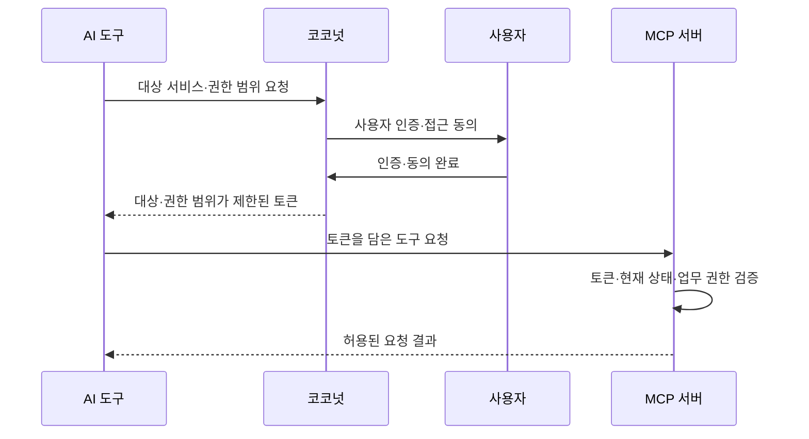
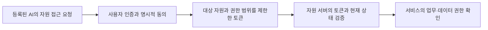

# COCONUT 브랜드 페이지 공개 근거

## 요약

COCONUT 브랜드 페이지의 기능·화면 설명에 대한 공개 기준과 검증 기록입니다.
현재 데이터는 [data/coconut.ts](../data/coconut.ts)의 `coconutAi`·`coconutAuthFlows`와 [data/solutions.ts](../data/solutions.ts)입니다. 이전 업데이트 항목과 검증은 이 문서의 이력으로 보존합니다.
기존 2026.09 PDF는 파일을 보존하되 현재 페이지의 다운로드 동선에서 제외했습니다. 최신 콘솔·MCP 검증 범위의 근거로 사용하지 않습니다.

## 2026-11-08 검토 후 반영

### 인증 흐름의 시각 표현 통일

사용자 로그인만 그림을 사용하고 API·MCP는 텍스트로 설명하던 차이를 정리했습니다. 기존 `BrandCoconutFlow`를 확장해 세 흐름 모두 같은 카드·연결선·토큰 이동·4단계 표시·다시 보기 구조를 사용합니다. 새 컴포넌트·이미지·외부 의존성은 추가하지 않습니다.

- 서버 간 API: 호출 서버 → 코코넛 자격 확인 → 호출 서버로 토큰 반환 → 대상 API 호출·업무 권한 검증을 표시합니다. 사용자 로그인이나 동의 단계는 넣지 않습니다.
- AI MCP: AI 도구의 연결 요청 → 코코넛에서 사용자 인증·동의 → AI 도구로 토큰 반환 → MCP 서버의 토큰·접근 상태·업무 권한 검증을 표시합니다. ‘개발 검증 중’ 상태를 유지합니다.
- 상세 단계 설명은 세 항목 모두 그림 아래 같은 위치의 펼침 영역으로 옮겼습니다. 데이터의 기존 단계 설명을 그대로 재사용하며 정적 HTML에도 남습니다.
- 920px 이하에서는 세 흐름 모두 세로형 SVG로 전환하고 최대 폭을 제한해 태블릿에서 글자가 작아지는 문제를 줄였습니다. PC 배치는 유지합니다.
- 정적 생성 통과. 세 패널·PC/모바일 SVG의 고유 ID, JS 실행 전 설명 노출, h1 1개, 기존 메타·FAQ JSON-LD 유지를 확인했습니다.
- 실제 브라우저에서 PC 1280px·모바일 390px·태블릿 768px의 탭 전환과 표시를 확인했습니다. 가로 넘침·SVG 텍스트 잘림 없음. 키보드 선택·상세 펼침·다시 보기 버튼도 확인했습니다.
- 동작 줄이기는 기존 SVG 정지·정적 단계 표시 로직을 유지한 것을 코드로 검토했습니다. 브라우저의 동작 줄이기 설정을 바꾼 재현 시험은 하지 않았습니다.

### 공개할 인증 범위

사용자 요청에 따라 사람의 로그인, 서버 간 API, AI MCP 인증을 동작 방식의 세 선택 항목으로 구분합니다. 코코넛은 신원 확인·토큰 발급을 맡으며, 연결한 서비스는 API·업무·데이터 권한을 확인한다는 경계를 유지합니다.

- 서버 간 인증 근거: 코코넛의 `ClientAdminService`·`AuthorizationServerConfig`, 피치의 `docs/specs/PRODUCT_INTEGRATION_AUTH.md`·`PRODUCT_INTEGRATION_CODES.md`와 `README.md`를 읽었습니다. Client Credentials 토큰 발급과 API 검증 구현을 제품 간 전체 업무 연동 완료로 확대하지 않습니다.
- 피치 연동 한계: 코코넛의 `docs/iam-extension/PEACH_ENTITLEMENT_REPLY.md`는 11/03 기준 PEACH 조회·한도 적용 후속 구현을 착수 전으로 기록합니다. 따라서 특정 제품명을 운영 완료 사례로 공개하지 않고 일반 서버 간 인증 흐름으로 설명합니다. 제품명·테넌트·Scope 원문·API 경로·자격 정보는 공개 설명에 넣지 않습니다.
- 서버 간 API 인증에서는 사용자가 로그인하거나 동의하는 단계가 없습니다. AI MCP 흐름은 사용자 인증·동의를 거치는 별도 흐름으로 표현하며 개발 검증 중 표시를 유지합니다.
- 기존 ‘스코프와 약관을 한 화면에서 동의’ 문구는 코코넛의 `templates/admin/client/form.html` 안내와 달라 정정했습니다. API 접근 권한 동의와 가입·이용 약관 절차를 구분합니다.

아래는 소개용 호출 흐름입니다. 인가 코드 교환·실패 응답 등 세부 프로토콜 단계는 생략했습니다.

### 콘텐츠와 사용성 정리

- AI 요약과 상세 흐름의 중복을 줄이고, 콘솔 투어를 AI 요약 직후로 옮겼습니다. AI·보안 카드의 핵심 설명은 모바일에서도 접지 않습니다.
- 도입 전후 비교는 도입 대상 안으로, 운영·설치 요구사항은 연동 상세 안으로 모았습니다. 독립 업데이트 섹션과 관련 미사용 데이터·소개서 동선을 정리하고 `#operations`·`#spec`·`#updates` 앵커는 상세 항목으로 보존합니다. PDF·기존 이미지 파일은 삭제하지 않았습니다.
- 기존 `BrandCoconutFlow`·`BrandFold`를 재사용했습니다. 신규 코드 파일·패키지는 추가하지 않았습니다. API·MCP 단계는 같은 데이터 구조와 반복 렌더링을 사용하며, JS 이전 HTML에는 세 흐름이 모두 들어갑니다.
- `FbZoomImage`는 기존 `LinkberryGallery`의 기본 HTML dialog 패턴을 적용했습니다. 원본 해상도 스크롤·전체 보기 전환, 초기 닫기 버튼 초점, 배경 접근 제한, Escape 종료와 호출 링크 초점 복귀를 연결했습니다. 기존의 작은 맞춤 표시만 하는 확대 창·전역 키 이벤트·미사용 CSS를 제거했습니다. 현재 사용처는 코코넛 페이지뿐입니다.
- 모바일 콘솔 선택 버튼은 서비스·인증 정책·브랜딩·약관 네 칸으로 배치해 320px에서도 가려지는 항목이 없도록 했습니다.

### 후속 검증

- 실제 브라우저의 320·390px 모바일, 768px 태블릿, 1280px PC에서 페이지 가로 넘침·이미지 오류 없음과 세 인증 흐름 선택을 확인했습니다. 확인 구간의 브라우저 오류는 없습니다.
- 확대 화면에서 1800px 원본 너비, 가로 키보드 스크롤, 전체 보기 전환, 닫기 버튼 초기 초점, 반복 Tab 시 창 내부 유지, Escape 종료·원래 링크 초점 복귀와 본문 스크롤 복구를 확인했습니다.
- 동일한 390px 뷰포트의 기본 사용자 로그인 흐름 선택 상태에서 콘솔 시작은 약 5,828px → 2,256px, 전체 페이지는 약 15,902px → 12,971px로 줄었습니다. 기기·글꼴·선택 항목에 따라 달라지는 UI 측정값이며 성능 보장 수치가 아닙니다.
- 첫 정적 빌드는 캐시 디렉터리 생성 권한 오류(EPERM)로 실패했습니다. 개발 서버를 종료하고 PC 권한으로 같은 `npm run generate`를 재실행해 통과했습니다(43개 프리렌더 산출물). 검사를 완화하거나 의존성을 추가하지 않았습니다. 기존 Browserslist/baseline 데이터·Nitro cache-driver 경고는 남습니다.
- 생성 HTML 16개(기존 noindex 호환 페이지 포함)에서 h1 각 1개, canonical·설명 존재, JSON-LD 파싱과 이미지 파일 존재를 확인했습니다. 코코넛 FAQ 11개 질문·답변이 HTML과 구조화 데이터에서 일치합니다. JS 이전 HTML에 세 인증 흐름이 모두 표시되며 기존 상세 앵커가 남아 있습니다. 이전 PDF 링크·잘못된 동의 문구·내부 PC 경로·피치 내부 연동명·접속 IP는 변경 페이지의 HTML에 없습니다.
- `git diff --check` 통과. 운영 API·DB·제품 설정·문의 제출·배포는 실행하지 않았습니다. JS 비활성화·OS 동작 줄이기 설정을 켠 별도 브라우저 실행은 하지 않았으며, 정적 HTML·기존 모션 방어 코드를 확인한 범위와 구분합니다.

### main 반영 전 최종 검토 (2026-11-08)

- 사용자 요청으로 최종 검토 후 Commit·main Push·GitHub Pages 배포가 승인되었습니다. 회사 표준 `project.json`·별도 qualityGate는 미채택이며 프로젝트 정본의 정적 생성·화면·GEO/AEO 검증을 적용했습니다. 회사 전체 보안·성능 인증 검토를 의미하지 않습니다.
- `review-fix-loop` 1회차에서 새 실행 가능한 지적이 없었으며 추가 코드 수정 없이 최종 읽기 전용 검토를 통과했습니다. `prettier --check`·`git diff --check` 통과, 배포와 같은 문의 엔드포인트로 `npm run generate` 성공을 확인했습니다.
- 생성 HTML 16개, 사이트맵 페이지 URL 15개, FAQ 11개 일치와 JS 이전 인증 흐름 3개 포함을 재확인했습니다. 사이트맵의 이미지 URL은 페이지 수에서 제외했습니다.
- 최종 브라우저 재검사에서 모바일 인증 흐름 전환·탭 가림 없음·확대 창 초점 유지/복귀·본문 스크롤 복구, PC 사용자 로그인 흐름·h1 1개·가로 넘침/깨진 이미지/브라우저 오류 없음을 확인했습니다. 별도 실서비스 API 호출은 하지 않았습니다.
- 원격 main과 기준 HEAD `e172358800616f2fd833982ebfda88d88325991e`가 일치했습니다. 배포 성공 여부와 운영 반영은 Push 이후 별도로 확인합니다.

## 2026-11-08 초기 브랜드 페이지 개편 이력

사용자 요청에 따라 최신 화면, AI 도구의 접근 인증·권한 통제와 계정·토큰·세션 보안을 먼저 소개합니다. 기존 `data/coconut.ts`와 `data/solutions.ts`, `FbZoomImage`·`BrandFold`를 재사용했습니다. 중복된 로그인 목업·약관 접힘 영역은 실제 화면 투어로 합쳤으며 별도 컴포넌트나 외부 의존성은 추가하지 않았습니다.

### 기능 설명의 근거와 범위

제품 저장소는 읽기 전용으로 확인했습니다. 로컬 main/HEAD 확인값은 `27e58ef7dd3ed08a3a3eb94a57f9f03bcb408a1c`(2026-11-05)이며 원격 fetch·배포 버전 대조는 하지 않았습니다. 개발 서버의 화면 확인과 코드 확인을 구분합니다.

| 공개 설명 | 확인 근거 | 공개 범위·한계 |
|---|---|---|
| 업무별 공통 콘솔 | 제품 `docs/UNIFIED_CONSOLE_ROUTES.md`, `UNIFIED_CONSOLE_PROGRESS.md`, 11/08 개발 서버 로그인 후 확인 | 조직·테넌트·클라이언트·사용자·모니터링 분류. 역할·관리 배정 범위를 넘는 권한을 보장하지 않음 |
| 서비스별 비밀번호·MFA, 공통 로그인 시도 제한 | 최신 클라이언트 생성 화면과 제품 `INTEGRATION_CHANGE_NOTICE_2026-10-24_ACCOUNT_LOCK.md` | 이전의 ‘클라이언트별 로그인 실패 잠금 설정’ 설명을 공통 기준으로 정정. 실제 설정 저장·변경은 하지 않음 |
| AI 인증·동의·자원/권한 범위 제한 | 제품 `docs/mcp/REQUIREMENTS_AND_PROGRESS.md`, `PRODUCT_DEVELOPMENT.md`, `ACCESS_VALIDATION_CONTRACT.md` | 구현·개발 검증 중. 실제 업무 데이터·다른 AI 호환·전체 운영 검수 완료로 표현하지 않음 |
| ChatGPT 가상 데이터 연결과 갱신·철회 | 제품 `docs/mcp/LOCAL_VALIDATION_AND_RELEASE.md`, `REQUIREMENTS_AND_PROGRESS.md`의 기존 실행 기록 | 이번 홈페이지 작업에서 AI 연결 시험·고객 데이터 조회를 새로 실행하지 않음 |
| 토큰·세션 종료와 감사 | 제품 `docs/mcp/ACCESS_VALIDATION_CONTRACT.md`, `IAM_EVENT_WEBHOOK_GUIDE.md`, 개발 서버 모니터링 메뉴 | 외부 서비스는 토큰 상태 검증·웹훅 수신과 자체 세션 종료를 구현해야 함. 즉시 차단 시간·가용성 보장 없음 |
| 브랜딩·약관 | 시험 클라이언트의 브랜딩/약관 화면 | 색상·로고·미리보기와 임시저장/게시, 약관 버전·필수 여부·상태. 게시·저장·동의 변경 없음 |

AI 인증 설명은 다음 역할 구분으로 제한합니다. AI의 응답 내용 검사나 모든 도구 실행의 자동 승인·차단을 제공한다고 설명하지 않습니다.

### 화면 자산

11/08 사용자가 개발 서버에 직접 로그인한 뒤 읽기 전용으로 확인했습니다. `public/images/solutions/coconut/`에 날짜가 붙은 새 파일을 추가해 기존 파일과 PDF를 보존합니다. 웹용은 최대 1600px WebP, 확대용은 캡처 해상도 WebP이며, OG/카드는 1600×900 JPEG입니다. 제품의 최신 심볼 SVG도 그대로 가져왔습니다.

| 자산 접두어 | 화면과 공개 처리 |
|---|---|
| `dashboard-202611` / `cover-202611` | 개발 통계와 그래프까지 사용. 최근 활동·계정·IP 영역은 캡처 범위에서 제외. 개발 수치임을 화면에 표시 |
| `client-setup-202611` | 신규 클라이언트의 빈 등록 폼. 테넌트 선택 목록은 닫힌 상태. 실제 시크릿·연락처 없음 |
| `security-202611` | 신규 등록 폼의 비밀번호·계정 보안·MFA 영역만 사용. 고객별 설정값 없음 |
| `branding-202611` | 시험 서비스의 로고·색상·미리보기·저장 옵션만 사용. 서비스 식별자·도움말·계정 정보 제외 |
| `terms-202611` | 시험 서비스의 표준 약관과 상태·동의 건수만 사용. 서비스 식별자와 동의자 개인정보 제외 |
| `mark-202611.svg` | 제품 저장소의 `static/images/brand/coconut-mark.svg` 원본 |

로그인 이력 캡처는 자동 승인 검토가 실제 계정/IP 노출 가능성을 이유로 거절하여 사용하지 않았습니다. 캡처 API가 영역의 시작 좌표를 반영하지 않는 문제가 있어 공개 설정 화면은 전체 뷰포트 캡처 후 로컬에서 영역을 잘라 시각 확인했습니다. 로그인 이력의 재캡처·우회는 하지 않았습니다.

### 기존 설명서와 검색 노출

이전 제품 설명서 원본 경로 `coconut/output/pdf/`는 현재 Checkout에 없어 재생성하지 않았습니다. 원본을 먼저 갱신하는 기존 프로젝트 원칙을 유지하며, PDF 파일은 변경하지 않고 링크에 ‘2026.09 기존 자료’를 명시했습니다. 히어로·모바일의 주요 동선은 최신 AI 인증 설명으로 연결합니다.

공개 본문·메타·홈/목록 요약·SoftwareApplication·FAQ JSON-LD가 같은 기능 상태를 설명하도록 공통 데이터를 갱신합니다. URL·canonical·색인 대상 경로·크롤러 정책은 유지합니다. 새 AI 설명과 흐름도는 정적 HTML에 포함합니다.

### 완료 검증

- `npm run generate` 성공(43개 프리렌더 산출물, 페이지 수와 별개). 오래된 Browserslist/baseline 데이터 및 기존 Nitro cache-driver 경고는 남았으며 의존성은 변경하지 않았습니다.
- 홈·솔루션 목록·코코넛 브랜드 페이지의 생성 HTML에서 h1 각 1개, 고유 제목·설명·canonical, JSON-LD 파싱, 핵심 본문·AI 개발 상태·이미지 파일 존재를 확인했습니다. 코코넛 FAQ 10개 질문·답변이 HTML과 JSON-LD에서 일치합니다. 변경 페이지의 예전 화면 참조·개발 PC 경로·접속 IP 노출은 없습니다.
- 실제 브라우저에서 1280px PC 및 390px·320px 모바일의 페이지 가로 넘침 없음, 이미지 로딩, 키보드 Enter 앵커 이동, 모바일 콘솔 탭 전환, 이미지 확대와 Escape 종료를 확인했습니다. 확인 구간의 브라우저 오류·경고는 없었습니다.
- 새 AI 영역은 모션 없이 표시합니다. 기존 reveal의 JS 실패 시 표시 방어, 정적 HTML의 전체 투어·FAQ 포함, `prefers-reduced-motion` 규칙은 코드로 확인했습니다. JS 비활성화·동작 줄이기 OS 설정을 켠 별도 브라우저 실행은 하지 않았습니다.
- `git diff --check` 통과. 실제 문의 제출·제품 설정 저장·AI 업무 연동·배포는 실행하지 않았습니다.

## 공개 기준

| 표시 | 기준 | 적지 않는 것 |
|---|---|---|
| 최근 추가 | 코코넛 제품 저장소 `main`에 반영된 기능. 날짜는 반영 월 | 브랜치에만 있는 기능 |
| 개발 중 | 구현이 진행 중이고 `main` 반영 전이거나 릴리스 검수가 끝나지 않은 기능 | 계획·검토 단계 기능, 제공 예정일 |

- 기본 설정이 꺼져 있거나 내부 연동용 기반인 기능은 `main`에 있어도 "최근 추가"로 소개하지 않습니다.
- 보안 보강 항목은 결과(무엇이 기본 적용되는지)만 적고, 이전 상태나 점검 결과는 공개하지 않습니다.
- "시연 가능" 같은 표현은 개발 서버에서 기능별 동작을 확인하기 전에는 쓰지 않습니다.
- 제목은 12자 안팎으로 둡니다. 모바일 접힘 행에서 한 줄로 보이게 하기 위해서입니다.

## 2026-09 기준 항목 (2026-09-29 확인)

| 항목 | 표시 | 근거 |
|---|---|---|
| 셀프서비스 고객 콘솔 | 최근 추가 (2026.09) | 공통 회원가입·조직 생성, 소유자·관리자·조회자 역할과 초대, 테넌트·클라이언트·가입 방식 관리가 `main`에 반영됨. 신규 조직은 운영자가 이용 한도를 설정한 뒤 사용 |
| 공통 계정 보안 화면 | 최근 추가 (2026.09) | 계정 보안 상태 API·화면 커밋 `main` 반영. 페이지 연동 항목의 기존 설명과 같음 |
| 이벤트 웹훅·세션 종료 | 최근 추가 (2026.08) | 사용자 이벤트 웹훅, 특정 세션 조회·폐기 커밋 `main` 반영 |
| 갱신 토큰 자동 교체 | 최근 추가 (2026.08) | Refresh Token Rotation 기본값 적용 커밋 `main` 반영 |
| AI 도구 연결 인증 (MCP) | 개발 중 | `main`에 반영됐지만 가상 데이터 연결 검증 단계이고 릴리스 검수가 끝나지 않음 |

## 제외한 후보

- **이용 제한 이력 보존:** 코드는 `main`에 있지만 기록 기능의 기본값이 꺼져 있고(`recordingEnabled = false`), 다른 사내 제품 연동을 위한 내부 기반이라 2026-09-29에 목록에서 뺐습니다.
- **승인 방식 관리자 가입:** 2026-09-23에 만들어졌지만 2026-09-25에 공통 회원가입·조직 콘솔로 대체됐습니다. 지금은 이미 받은 신청을 처리하는 용도로만 남아 있어 2026-09-29에 목록에서 뺐습니다. 커밋 제목만 보지 말고 기능 문서에서 대체 여부를 확인해야 하는 사례입니다.
- **시스템 관리자 MFA 필수:** 이후 변경으로 로그인 클라이언트의 MFA 정책을 따르게 되어 "필수"라고 쓸 수 없습니다.
- **연동 서비스의 계정 상태 조회 권한:** 브랜치에만 있고 기본값이 꺼져 있는 내부 연동용 기능이라 공개 대상에서 뺐습니다.

## 갱신 방법

1. 코코넛 제품 저장소의 `main`과 진행 중인 브랜치를 함께 확인하고, 커밋 제목이 아니라 기능 문서에서 현재 동작과 대체 여부를 확인합니다.
2. `coconutUpdates`와 `coconutUpdatesAsOf`를 고치고, 이 문서의 표를 같은 기준으로 갱신합니다.
3. 코코넛 제품 설명서를 먼저 갱신하는 원칙은 그대로 따릅니다.
