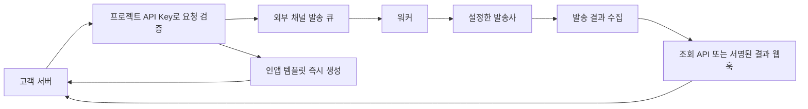

## 요약

2026-11-08에 라임 소스와 연동 문서를 확인해 `/solutions/lime/`을 브랜드 페이지로 확장했습니다. 기존 브랜드 레이아웃·헤더·모바일 접기 요소와 SEO·JSON-LD 도구를 재사용합니다. 별도 페이지와 데이터 파일은 라임 고유의 채널·발송 흐름·도입 조건을 담기 위해 추가했습니다. 새 의존성은 없습니다.

사용자가 로그인한 운영 사이트에서 대시보드·템플릿 생성·메시지 작성 화면을 확인하고 JPEG 스크린샷 3개를 반영했습니다. 첫 화면과 홈·허브 카드·링크 미리보기에는 실제 대시보드를, 운영 관리 영역에는 템플릿·메시지 작성 예시를 사용합니다. 기존 개념도와 사용하지 않는 전용 CSS는 정리했습니다. 제품 소개서는 이번 범위에 포함하지 않습니다.

## 구현과 정본

| 파일                                        | 역할                                                     |
| ------------------------------------------- | -------------------------------------------------------- |
| `pages/solutions/lime.vue`                  | 라임 브랜드 페이지. 기존 `/solutions/lime/` 주소 유지    |
| `data/solutions.ts`                         | 홈·허브 소개, 검색 메타, FAQ, 구조화 데이터, 브랜드 색상 |
| `data/lime.ts`                              | 라임 고유 채널 설명·발송 흐름·운영 관리·연동·도입 절차   |
| `public/images/solutions/lime/mark.svg`     | 라임 소스의 기존 심볼 사본. 새 로고 제작 없음            |
| `public/images/solutions/lime/*-202611.jpg` | 로그인 후 확인한 실제 관리 화면 3개                      |

기술 구성은 이전 소개의 Express·Knex·Objection.js에서 현재 소스의 NestJS·TypeORM으로 갱신했습니다. 공개 경로 수는 그대로입니다. 본문·FAQ·메타는 확인한 채널과 제약을 함께 설명하며, 가격·처리량·가용성·인증 획득 등 확인하지 않은 보장은 추가하지 않았습니다.

## 확인 근거

아래 경로는 라임 원본 저장소 `C:\project\fourberry\lime`을 기준으로 합니다. 라임 원본은 읽기만 했으며, 환경 파일·인증정보·고객 데이터는 사용하지 않았습니다. 이 문서는 내부 근거 기록이며 `public/`에 복사하지 않습니다.

| 공개 설명                                                | 확인한 소스·문서                                                                                                                | 판단 범위                                                                         |
| -------------------------------------------------------- | ------------------------------------------------------------------------------------------------------------------------------- | --------------------------------------------------------------------------------- |
| 문자·카카오·이메일·앱 푸시·웹 푸시·Google Chat·인앱      | `apps/docs/start/introduction.md`, `apps/docs/channels/*.md`, `apps/worker/src/app/app.module.ts`, `apps/worker/src/adapters/`  | 소스의 연결 구현과 문서 기준. 운영 환경의 개별 계정 연결은 미확인                 |
| 문자·카카오는 뿌리오, 이메일은 SMTP, 앱 푸시는 FCM       | 해당 채널 문서, `apps/worker/src/adapters/*/providers/`                                                                         | Mock와 실발송 구현을 구분. APNS 파일의 존재만으로 지원을 단정하지 않음            |
| 웹 푸시는 정보성 즉시 단건, 고객 서비스의 구독 관리 필요 | `apps/docs/channels/webpush.md`, `apps/worker/src/adapters/webpush/webpush.adapter.ts`                                          | 고객이 HTTPS·Service Worker·알림 동의·구독 수명주기를 구현                        |
| 인앱 문구 즉시 반환, 외부 발송·웹훅 없음                 | `apps/docs/channels/inapp.md`, `apps/external-api/src/app/messages/messages-v2.controller.ts`                                   | 인앱 알림함·화면 제공을 주장하지 않음                                             |
| API Key와 프로젝트 범위                                  | `apps/docs/start/authentication.md`, `apps/docs/start/quickstart.md`, 외부 API 컨트롤러의 `ApiKeyGuard`·`ActiveProject`         | 서버 간 호출, 키의 클라이언트 노출 금지                                           |
| 템플릿·변수·이메일 레이아웃·관리 화면 기능               | `apps/docs/concepts/templates.md`, `apps/client-web/src/constants/navigation.ts`, `apps/client-web/src/pages/`                  | 소스상의 관리 기능. 실제 화면 스크린샷은 추후 확인                                |
| 예약·취소·대량 발송 및 채널 제한                         | `apps/docs/concepts/scheduling.md`, `apps/docs/sending/bulk.md`, `apps/external-api/src/app/messages/messages-v2.controller.ts` | 인앱·웹 푸시는 예약·대량 발송 제외                                                |
| 접수·발송사 접수·도달 리포트 구분                        | `apps/docs/concepts/message-status.md`, 채널 문서                                                                               | 수신 완료와 읽음 여부를 구분. 모든 채널의 도달 보장 없음                          |
| 결과 웹훅의 서명·중복 처리, 중복 요청 방지 키            | `apps/docs/sending/webhooks.md`, `apps/docs/concepts/idempotency.md`, 외부 API의 `Idempotency-Key` 처리                         | 고객 수신 서버의 검증·중복 처리가 필요                                            |
| 현재 기술 구성                                           | `package.json`, `apps/worker/src/app/app.module.ts`, `libs/core/database/`                                                      | NestJS·TypeORM·MySQL·BullMQ·Redis·Vue 3. 정확한 설치 용량과 지원 수준은 별도 협의 |
| 원본 심볼·녹색                                           | `apps/client-web/src/assets/brand/lime-mark.svg`                                                                                | 원본 마크와 주 색상 `#3E7717` 재사용. 홈페이지용 보조 색상만 구성                 |

준비 중인 발송사·연동은 `apps/docs/start/introduction.md`와 채널 문서를 기준으로 별도 표기합니다. 소스 문서와 구현이 바뀌면 공개 설명도 다시 확인해야 합니다. 운영 배포 상태를 소스만으로 확정하지 않습니다.

## 실제 화면 캡처

2026-11-08에 사용자가 내장 브라우저에서 직접 로그인한 뒤 촬영했습니다. 스크린샷은 브라우저에서 직접 JPEG로 저장했으며 생성형 이미지로 재구성하거나 운영 수치를 바꾸지 않았습니다. 저장 파일을 다시 열어 공개 범위를 확인했습니다.

| 이미지                       | 크기        | 공개 범위와 제외 항목                                                                                   |
| ---------------------------- | ----------- | ------------------------------------------------------------------------------------------------------- |
| `dashboard-202611.jpg`       | 1310 × 912  | 현황 카드·발송 추이·채널 비중만 포함. 최근 발송 목록·수신자·사용자 메뉴 제외                            |
| `template-editor-202611.jpg` | 1310 × 1120 | 목록을 빈 조회 상태로 바꾸고 라임 자체 프로젝트에서 미저장 예약 안내 예시를 작성. 고객 목록·계정명 제외 |
| `message-compose-202611.jpg` | 1310 × 1120 | 빈 조회 목록 위의 미발송 작성 예시. 수신자·발신자는 미입력, 계정명 제외                                 |

캡처 파일 3개의 합계는 약 285KB입니다. 원본에는 고객명·수신자 목록·전화번호·계정 이메일·API Key가 포함되지 않도록 화면과 범위를 선택했습니다. 계정 아바타가 있는 하단 영역은 제외했습니다. 템플릿 예시는 미리보기만 실행하고 생성을 취소했으며, 메시지는 발송하지 않고 취소했습니다. 촬영 후 검색 조건을 비우고 대시보드로 돌아왔습니다.

대시보드의 수치는 촬영 시점의 데이터이며 성능·가용성·처리량 보장을 뜻하지 않는다고 화면에 안내합니다. 템플릿과 발송 화면의 예시 상태도 각각 설명합니다. 이미지는 기존 `FbZoomImage`로 확대하며 제목·설명·대체 텍스트를 HTML로 함께 제공합니다. 실제 발송·예약·기존 데이터 수정은 실행하지 않았습니다.

## 발송 흐름

접수 성공은 발송·수신 완료를 뜻하지 않습니다. `delivered`는 발송사 도달 리포트가 있는 경우에만 확인하며 읽음 상태를 뜻하지 않습니다. 인앱은 큐와 결과 웹훅을 거치지 않습니다.

## 검증과 한계

- `npm run generate`의 최종 실행이 성공했습니다. 최초 샌드박스 실행은 Nuxt 서버 캐시 폴더 생성에서 `EPERM`으로 중단됐고, 권한 확장 후 같은 명령으로 검증했습니다. 브라우저 호환 데이터의 갱신 권고와 Nuxt cache-driver의 외부 의존성 처리 경고는 남아 있으나 정적 생성은 완료됐습니다. 의존성은 변경하지 않았습니다.
- 홈·솔루션 허브·솔루션 상세 3개, 총 5개 페이지의 생성 HTML을 확인했습니다. 페이지당 h1 1개, 고유 제목, 설명·canonical·OG URL, 구조화 데이터 파싱과 데이터 일치 검사가 통과했습니다. 라임 FAQ 9개의 본문·JSON-LD 일치, 정적 본문·채널 설명, 내부 링크·앵커·이미지 경로, 사이트맵 15개 URL 유지를 확인했습니다.
- 공개 HTML·JS·JSON·CSS에서 확인 대상 내부 경로와 비밀 설정 이름이 검출되지 않았습니다. 검사 중 나온 `HOMEPAGE_CONTACT`는 기존 문의 폼의 공개 템플릿 식별자이며 비밀 키가 아닙니다. 환경 파일과 실제 비밀 값은 열지 않았으므로 모든 비밀정보를 대조한 전수 검사로 표현하지 않습니다.
- 변경 파일의 Prettier 검사와 diff 공백 검사, 원본·복사 심볼의 SHA-256 일치 확인이 통과했습니다.
- JS 실행 전에도 핵심 내용·채널 설명·FAQ·링크가 HTML에 있습니다. 모바일 접기는 기존 `BrandFold`·`useIsMobile`을 재사용하며 SSR에서 열린 상태입니다. 기존 JS 실패 시 표시 방어와 동작 줄이기 CSS를 유지합니다.
- 로그인 후 실제 콘솔 화면과 공개 캡처 파일을 확인했습니다. 브랜드 페이지는 데스크톱 1280px·모바일 390px에서 가로 넘침이 없고, 이미지 3개 로딩과 모바일 갤러리 한 열 배치, 운영 설명 접기·문의 바, 헤더 아래 앵커 위치를 확인했습니다. Enter로 확대 창 열기·Esc로 닫기·원래 링크로 초점 복귀가 동작합니다. 테스트용 화면 크기는 원복하고 로컬 미리보기 서버는 종료했습니다. JS 실패 시 표시와 동작 줄이기는 정적 HTML·기존 CSS를 확인했으며 별도 브라우저 설정으로 재현하지 않았습니다. 실제 발송 성공을 검증한 것은 아닙니다.
- 스크린샷 반영 후 정적 생성과 HTML 검사를 다시 통과했습니다. 이미지 대체 텍스트·크기·확대 링크, 대표 이미지·OG 이미지 일치, 배포 산출물의 이미지 바이트 일치도 확인했습니다. 페이지 본문의 주요 기능과 FAQ는 이미지 없이도 HTML로 읽을 수 있습니다.
- 문의 클릭은 기존 `solution_inquiry_click`을 사용합니다. 라임은 `solution: LIME`, 위치는 헤더 `brand_header`, 상단 `hero`, 하단 `pilot`, 모바일 고정 바 `mobile_bar`입니다. 실제 문의 전송이나 운영 GA 수신은 실행하지 않습니다.
